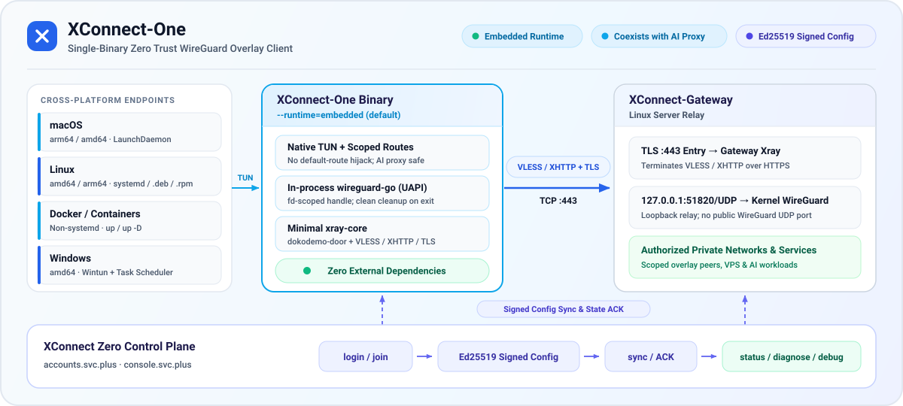

# XConnect-One

<p align="center">
  
</p>

## Open-source zero-trust overlay client | 开源零信任内网互联客户端

**XConnect-One** is the single-binary, cross-platform endpoint client for **XConnect Zero** — a self-hostable Zero Trust WireGuard overlay carried over VLESS/XHTTP TLS (`443`). It runs across **macOS, Linux, Docker containers, and Windows** with zero external runtime dependencies and coexists cleanly with everyday AI proxy tools.

**XConnect-One** 是 **XConnect Zero** 的单二进制跨平台终端客户端，基于 VLESS/XHTTP TLS（`443`）承载零信任 WireGuard 内网隧道，支持 **macOS、Linux、Docker 无 systemd 容器和 Windows**。内置精简版 `xray-core` 与 `wireguard-go`，不劫持默认路由，可与现有 AI 代理加速工具无缝共存。

<p align="center">
  
</p>
<p align="center"><sub>Architecture overview · 单二进制 WireGuard-over-VLESS/XHTTP 零信任内网互联架构。</sub></p>

### What you can do | 主要功能

- **Single-binary embedded runtime｜单二进制内嵌运行时** — Bundles minimal `xray-core` (`dokodemo-door` + `vless/xhttp/tls`, excluding ~29 MB geo assets) and `wireguard-go` (in-process UAPI) with native TUN/route setup (`--runtime=embedded`, default; optional `--runtime=external` fallback).
- **Coexist with AI proxies｜与 AI 代理无缝共存** — Tunnels WireGuard over HTTPS (`443`) without hijacking your default route, seamlessly interconnecting Linux VPS, containers, and desktops alongside existing AI proxy clients.
- **Cross-platform & container native｜跨平台与容器原生支持** — Supports **macOS** (LaunchDaemon), **Linux** (systemd / `.deb` / `.rpm`), **non-systemd Docker containers** (`up` / `up -D`), and **Windows** (Wintun + Task Scheduler) with automatic fd-scoped TUN cleanup.
- **Zero-trust security & diagnostics｜零信任安全与自愈诊断** — Ed25519-signed configs, global unique `/etc/xconnect-one/device-id`, automatic network-change / sleep-wake hot recovery, plus `status`, `diagnose`, and AI-ready `debug --prompt`.

### Start in three steps | 三步开始

**Install → Login & join → Start tunnel**<br />
**安装 → 登录并入网 → 启动零信任隧道**

1. **Install｜安装** — Download a release package or binary for your platform from [GitHub Releases](https://github.com/ai-workspace-xstream/xconnect-one/releases), or follow the [Cross-Platform Install & Deployment Guide](docs/cross-platform-install-and-deployment.md) for Homebrew, source build, and OS autostart setup.
2. **Login & join｜登录并入网** — Sign in with `xconnect-one login` and enroll your device with `xconnect-one join --gateway <url>` (or pass a one-time invite link from the console).
3. **Start & verify｜启动并验证** — Launch the tunnel with `sudo xconnect-one up -D` (or enable systemd / LaunchDaemon / Task Scheduler), then inspect connectivity via `xconnect-one status` and `xconnect-one diagnose`.

> Supports both account login and one-time invite links (`xconnect-one join "xconnect://join/<token>?controller=https%3A%2F%2Faccounts.svc.plus"`); Apache 2.0 licensed and 100% self-host friendly. 支持账号登录与控制台一次性邀请码入网；基于 Apache 2.0 协议开源，支持全链路私有化自建。

See the [XConnect Zero Console (Online Demo)](https://console.svc.plus/panel/xconnect-zero), [XConnect-Gateway](https://github.com/ai-workspace-xstream/xconnect-gateway), [XConnect App](https://github.com/ai-workspace-xstream/xconnect-app), [Quick TL;DR Guide](docs/xconnect-zero-cloud-tldr.md), and [CLI User Guide (中文)](docs/cli-user-guide.zh-CN.md) for details.

## TL;DR

```bash
xconnect-one login
xconnect-one join --gateway https://ph-xconnect-gateway-01.svc.plus
sudo xconnect-one up -D
sudo xconnect-one status
sudo xconnect-one diagnose
sudo xconnect-one down
```

## 独立加速 | Linux VPS

```bash
xconnect accelerate login
xconnect accelerate join
sudo xconnect accelerate up
# 在另一个终端
sudo xconnect accelerate status
sudo xconnect accelerate down
```

已有 One 登录会话可直接运行 `accelerate join`。加速默认作用于发起 `sudo` 的普通用户。
root 登录的 VPS 需要指定运行应用的普通用户 UID，例如
`xconnect accelerate up --uid 1001`。`accelerate join` 会列出账号授权的加速节点，也可用 `--node <ID>` 直接选择。节点选择与 One 的 Gateway 独立。
用 `--state-dir` 指定已有的登录目录。支持 VLESS/TLS 的 TCP 和 XHTTP 节点。
`up` 在前台运行，Ctrl+C 也可停止。

加速使用独立的 TUN。现有路由规则和主路由表中比默认路由更具体的路由优先，
因此 One 私网和 LAN 保留原有路径。目标用户剩余的公网 IPv4/IPv6 流量进入加速，
系统 DNS 设置和其他用户的路由保持原样。如果现有 VPN 已接管公网流量，
其优先级更高的规则仍生效。运行主机需提供 `/dev/net/tun` 和 Linux 网络管理权限。

## Downloads

<!-- SUPPORT_MATRIX:START -->
| 平台 | 架构 | 测试状态 | 下载 |
|------|------|----------|------|
| macOS | arm64 | ✅ 已测试 | [DMG](https://github.com/ai-workspace-xstream/xconnect-one/releases/download/v0.1.22/xconnect-one-macos-arm64.dmg) / [Binary](https://github.com/ai-workspace-xstream/xconnect-one/releases/download/v0.1.22/xconnect-macos-arm64) |
| macOS | amd64 | ⚠️ 未测试 | [DMG](https://github.com/ai-workspace-xstream/xconnect-one/releases/download/v0.1.22/xconnect-one-macos-amd64.dmg) / [Binary](https://github.com/ai-workspace-xstream/xconnect-one/releases/download/v0.1.22/xconnect-macos-amd64) |
| Linux | amd64 | ✅ 已测试 | [DEB](https://github.com/ai-workspace-xstream/xconnect-one/releases/download/v0.1.22/xconnect-one_0.1.22_amd64.deb) / [RPM](https://github.com/ai-workspace-xstream/xconnect-one/releases/download/v0.1.22/xconnect-one-0.1.22.x86_64.rpm) / [TAR.GZ](https://github.com/ai-workspace-xstream/xconnect-one/releases/download/v0.1.22/xconnect-one-linux-amd64.tar.gz) / [ZIP](https://github.com/ai-workspace-xstream/xconnect-one/releases/download/v0.1.22/xconnect-one-linux-amd64.zip) / [Binary](https://github.com/ai-workspace-xstream/xconnect-one/releases/download/v0.1.22/xconnect-one-linux-amd64) |
| Linux | arm64 | ⚠️ 未测试 | [DEB](https://github.com/ai-workspace-xstream/xconnect-one/releases/download/v0.1.22/xconnect-one_0.1.22_arm64.deb) / [RPM](https://github.com/ai-workspace-xstream/xconnect-one/releases/download/v0.1.22/xconnect-one-0.1.22.aarch64.rpm) / [TAR.GZ](https://github.com/ai-workspace-xstream/xconnect-one/releases/download/v0.1.22/xconnect-one-linux-arm64.tar.gz) / [ZIP](https://github.com/ai-workspace-xstream/xconnect-one/releases/download/v0.1.22/xconnect-one-linux-arm64.zip) / [Binary](https://github.com/ai-workspace-xstream/xconnect-one/releases/download/v0.1.22/xconnect-one-linux-arm64) |
| Windows | amd64 | ✅ 已测试 | [Portable ZIP](https://github.com/ai-workspace-xstream/xconnect-one/releases/download/v0.1.22/xconnect-one-windows-amd64.zip) / [EXE](https://github.com/ai-workspace-xstream/xconnect-one/releases/download/v0.1.22/xconnect-one-windows-amd64.exe) |

> 当前下载链接指向 GitHub Release [`v0.1.22`](https://github.com/ai-workspace-xstream/xconnect-one/releases/tag/v0.1.22)（校验文件：[`SHA256SUMS`](https://github.com/ai-workspace-xstream/xconnect-one/releases/download/v0.1.22/SHA256SUMS)）。
<!-- SUPPORT_MATRIX:END -->

See [GitHub Releases](https://github.com/ai-workspace-xstream/xconnect-one/releases) for all build artifacts, or the [Cross-Platform Install & Deployment Guide](docs/cross-platform-install-and-deployment.md) for Homebrew, source builds, Docker containers, and autostart services.

## Learn More

- [Quick TL;DR Guide (中文)](docs/xconnect-zero-cloud-tldr.md)
- [Cross-Platform Install & Deployment Guide (macOS / Linux / Docker / Windows / Gateway)](docs/cross-platform-install-and-deployment.md)
- [CLI User Guide & Command Reference (中文)](docs/cli-user-guide.zh-CN.md)
- [Architecture: WireGuard over VLESS/XHTTP (EN)](docs/architecture/xconnect-zero-wireguard-over-vless.md) / [中文](docs/architecture/xconnect-zero-wireguard-over-vless.zh-CN.md)
- [Multi-Peer Adaptive Data Plane Design (中文)](docs/architecture/one-peer-path-manager.zh-CN.md)
- [macOS LaunchDaemon Autostart & Runtime Recovery](docs/macos-runtime-setup.md)
- [macOS Controlled-Client Runtime](docs/macos-controlled-client-integration.md)
- [Windows Runtime & Wintun Guide](docs/windows-runtime.md)
- [Self-Hosted Installation & Validation](docs/self-hosted-install-and-validation.md)
- [Device Self-Registration Workflow](docs/self-registration.md)
- [Desktop UAT Verification (macOS & Windows)](docs/desktop-uat-verification.md)
- [XConnect App Bridge Protocol v1](docs/integrations/xconnect-app-bridge-v1.md)
- [Experimental Zero Lab Controller](docs/zero-lab.md)

## License

Licensed under the [Apache License 2.0](LICENSE).
